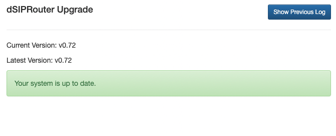
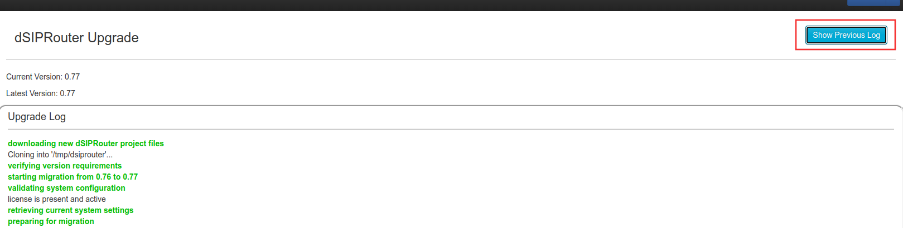
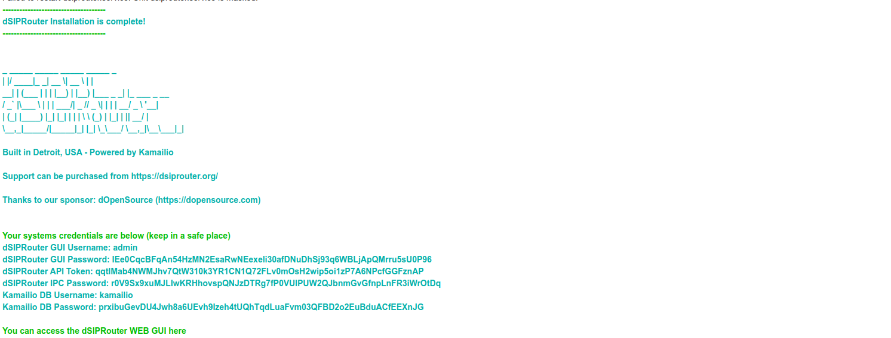
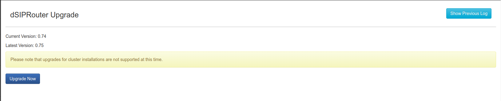

.. _upgrading:

Upgrading dSIPRouter
====================

Auto Upgrade Feature
--------------------

The dSIPRouter auto upgrade feature allows you to upgrade dSIPRouter from the User Interface (UI) and the command line (CLI).
If you are upgrading from 0.70, 0.72, or 0.721 you can boostrap to the latest release to get the auto-upgrade feature.

Upgrading to 0.73 doesn't require a dSIPRouter Core Subscription license because the auto-upgrade framework was not yet feature complete.
However, all subsequent releases of dSIPRouter require a Core Subscription License to use the auto-upgrade feature.
A core license can be purchased from the `dSIPRouter Marketplace <https://dopensource.com/product/dsiprouter-core/>`_.

Upgrading from the UI requires the ``dsip_admin`` role.
Both the UI and the CLI offer every release the installed version can be upgraded to.
A release can be upgraded to when its upgrade settings (``resources/upgrade/<release>/settings.json``) list the installed version under ``depends``.
From the CLI the supported releases are listed with ``dsiprouter upgrade -list`` and one is installed with ``dsiprouter upgrade -rel <release>``.
Without ``-rel`` the latest supported release is installed.

The releases are tracked from the repo set in the upgrade settings (``/etc/dsiprouter/upgrade_settings.py``).
Upgrades are run as root from that repo, so the file can only be changed by root:

- ``GIT_REPO_URL`` is the git repo releases are tracked from, it must be an https url. Releases are tagged ``v<version>-rel``.
- ``GIT_TRACK_BETA_RELEASES`` enables upgrading to beta releases, which are releases published as a pre-release on GitHub and tags such as ``v0.794-beta``. It is disabled by default.
- ``GIT_RELEASE_URL`` is only needed for a repo that is not hosted on github.com but provides a releases API in the GitHub format. It is used to find the releases published as a pre-release.

An upgrade installs software and restarts services, which the dSIPRouter UI is not allowed to do itself.
The UI requests the upgrade and the ``dsip-request-upgrade`` systemd service runs it.
The output of the upgrade is written to ``/var/log/dsiprouter/upgrade.log``.

If an upgrade fails the system is restored to its previous state.
This includes the kamailio and rtpengine packages, which are reinstalled at the versions that were installed before the upgrade.

Note that during upgrades, the hashed passwords have to be reset (such as dsiprouter admin password).
You can find the new passwords displayed; either on the CLI after completion, or by viewing the upgrade log in the UI:

Root restores system files from the backups in ``/var/backups/dsiprouter``.
Previous versions let the ``dsiprouter`` user write to that directory, so what it holds from then is moved to ``/var/backups/dsiprouter/untrusted.<random>`` by the upgrade.
Nothing is restored from that directory, also not the system files that were saved when dSIPRouter was installed (package sources, DNS and network settings, motd).
Review its content and move those files back to ``/var/backups/dsiprouter`` before dSIPRouter is uninstalled, otherwise the uninstall does not put them back.

Upgrades and reloads requested from the UI restart the services.
A request of the same kind made less than 60 seconds after the last one is started once the 60 seconds have passed.

Upgrade to 0.794
--------------------

Upgrading from version 0.78, 0.79, 0.791, 0.792, or 0.793 to 0.794 can be done using the auto upgrade feature via the UI or CLI.

To upgrade using the UI click the "Upgrade Now" button:

Or by using the CLI:

.. code-block:: bash

   dsiprouter upgrade -rel 0.794

What is reinstalled depends on the installed version:

- From 0.793 dSIPRouter is reinstalled. Kamailio keeps its config and its database, both are only updated to the new version.
- From 0.79, 0.791 and 0.792 Kamailio is reinstalled as well, if it is installed. The data of its database is saved before and restored after the reinstall.
- From 0.78 RTPEngine is reinstalled too, if it is installed, and its config is generated again.
  The systemd units of nginx and dnsmasq get the drop-in newer versions install, unless a unit was changed after 0.78 installed it.
  An install of 0.78 that is not located in ``/opt/dsiprouter`` can not be upgraded.
- From every version RTPEngine is also reinstalled when the installed RTPEngine is not the version this release installs for the operating system.

The upgrade lists the services that have to be restarted when it is done.
The ``sudoers`` file of previous versions (``/etc/sudoers.d/99-dsiprouter``) is removed by the upgrade.
When the upgrade was started from the UI its output can be viewed on the upgrade page afterwards, also when the upgrade failed and the previous version was restored.

Upgrade to 0.793
--------------------

Upgrading from version 0.78, 0.79, 0.791, or 0.792 to 0.793 can be done using the auto upgrade feature via the UI or CLI.

To upgrade using the UI click the "Upgrade Now" button:

Or by using the CLI:

.. code-block:: bash

   dsiprouter upgrade -rel 0.793

Upgrade to 0.78
--------------------

Upgrading from version 0.77 to 0.78 can be done using the auto upgrade feature via the UI or CLI.

To upgrade using the UI click the "Upgrade Now" button:

Or by using the CLI:

.. code-block:: bash

   dsiprouter upgrade -rel 0.78

Upgrade to 0.77
--------------------

Upgrading from version 0.76 to 0.77 can be done using the auto upgrade feature via the UI or CLI.

To upgrade using the UI click the "Upgrade Now" button:

Or by using the CLI:

.. code-block:: bash

   dsiprouter upgrade -rel 0.77

Upgrade to 0.76
--------------------

Upgrading from version 0.75 to 0.76 can be done using the auto upgrade feature via the UI or CLI.

To upgrade using the UI click the "Upgrade Now" button:

Or by using the CLI:

.. code-block:: bash

   dsiprouter upgrade -rel 0.76

Upgrade to 0.75
---------------

Upgrading to 0.75 can be done from a version greater than or equal to 0.72.
Upgrading from version 0.73 or 0.74 can be done using the UI:

Or by using the CLI:

.. code-block:: bash

   dsiprouter upgrade

To upgrade from 0.72 or 0.721 use the command below to bootstrap the upgrade:

.. code-block:: bash

   curl -s https://raw.githubusercontent.com/dOpensource/dsiprouter/v0.75/resources/upgrade/v0.75/scripts/bootstrap.sh | bash

Upgrade 0.73 to 0.74
--------------------

Upgrading from version 0.73 to 0.74 can be done using the auto upgrade feature via the UI or CLI.

Upgrade 0.72x to 0.73
---------------------

Upgrading to 0.73 can be done from 0.72 or 0.721 by doing the following

1. SSH to your dSIPRouter Instance
2. Run the following command

.. code-block:: bash

   curl -s https://raw.githubusercontent.com/dOpensource/dsiprouter/v0.73/resources/upgrade/v0.73/scripts/bootstrap.sh | bash

3. Login to the dSIPRouter UI to validate that the upgrade was successful.

**Note**, if you are upgrading from a debian 9 system you must first upgrade OS versions to a supported version.
See the `debian upgrade <https://wiki.debian.org/DebianUpgrade>`_ documentation for more information.

Note, if the upgrade fails you can purchase a dSIPRouter Core Subscription from the `dSIPRouter Marketplace <https://dopensource.com/product/dsiprouter-core/>`_.
This will provide you with support hours so that we can help with the upgrade.

Upgrade 0.70 to 0.721
---------------------

You can upgrade from 0.70 by doing the following

1. SSH to your dSIPRouter Instance
2. Run the following command

.. code-block:: bash

   curl -s https://raw.githubusercontent.com/dOpensource/dsiprouter/v0.721/resources/upgrade/v0.721/scripts/bootstrap.sh | bash

3. Login to the dSIPRouter UI to validate that the upgrade was successful.  

Note, if the upgrade fails you can purchase a dSIPRouter Core Subscription which can be purchased from the `dSIPRouter Marketplace <https://dopensource.com/product/dsiprouter-core/>`_.
This will provide you with support hours so that we can help with the upgrade.

Upgrade 0.70 to 0.72
--------------------

This upgrade path is deprecated. Upgrade to the **0.721** release instead.

Upgrade 0.644 to 0.70
---------------------

There is no automated upgrade available from 0.644 to 0.70.
Support is available via a dSIPRouter Core Subscription which can be purchased from the `dSIPRouter Marketplace <https://dopensource.com/product/dsiprouter-core/>`_.This will provide you with support hours so that we can help with the upgrade.

Upgrade 0.621 to 0.63
---------------------

.. include:: upgrade_0.621_to_0.63.rst

Upgrade 0.522 to 0.523
----------------------

.. include:: upgrade_0.522_to_0.523.rst

Upgrade 0.50 to 0.51
--------------------

.. include:: upgrade_0.50_to_0.51.rst
